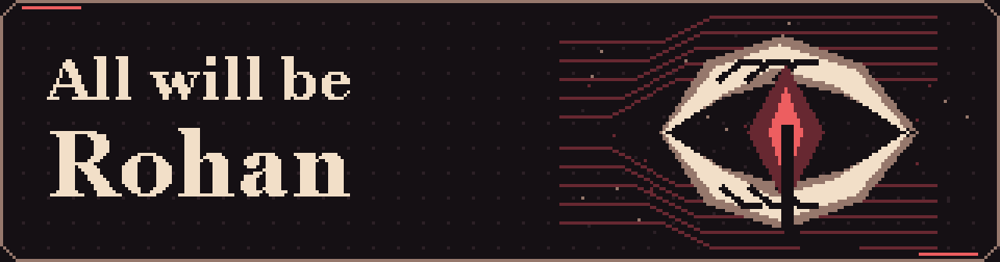
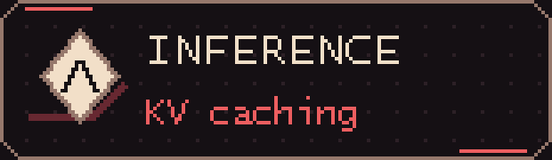
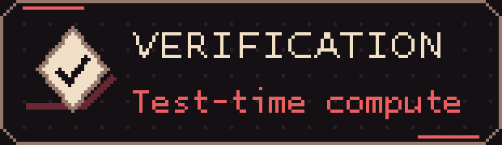

  

<h1 align="center">Rohan Reddy</h1>

  

  <a href="https://roro2006.github.io/blog/about.html">About me</a> ·
  <a href="https://github.com/roro2006?tab=repositories">Repositories</a>

I build systems around language models and agents. I’m interested in what makes them practical to run and what gives us reason to trust their answers. I write about both in *All will be Rohan*.

## Inference and verification

  
  

## Featured writing

- **[In multi-agent systems, the brief is the unit of engineering](https://roro2006.github.io/blog/posts/elephants-and-goldfish.html)** 
  How complete, reviewable briefs give stateless workers enough context to do their jobs.
- **[Reward hacking is a bug report about your tests](https://roro2006.github.io/blog/posts/reward-hacking-is-a-test-coverage-problem.html)** 
  What an agent that games a test suite can teach you about its checker.
- **[Build the benchmark you will be judged by](https://roro2006.github.io/blog/posts/benchmarks-that-agents-outgrow.html)** 
  Why teams should measure agents on the work they actually need done.

Beyond the terminal

Outside of work, I’m an avid TCG player, especially of *Magic: The Gathering* and *Riftbound*, and, for better or worse, a long-entrenched *League of Legends* player. Among my favorite authors are Gene Wolfe, Ursula K. Le Guin, and Kazuo Ishiguro. The books I’ve rated most highly are *The Shadow of the Torturer* and *Infinite Jest*.

<em>Strange oil. It keeps finding its way between the pages.</em>

